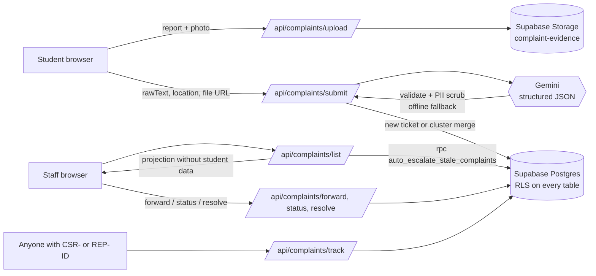

# Campus Speedrun

**AI-Powered Academic & Infrastructure Triage Engine**

Students report broken lab equipment, electrical hazards, network outages and sanitation failures anonymously. Gemini triages each report into a scored, routed ticket, and a strict 3-tier, 72-hour escalation chain makes sure nobody can let it sit.

## The problem

- **Fear of reporting.** Students stay quiet about broken equipment or negligence because their name reaches the staff who grade them.
- **Chronological queues bury hazards.** A sparking ceiling fan filed at 9:00 sits behind a cosmetic request filed at 8:55.
- **Tickets stagnate.** Complaints wait in one person's inbox with no deadline and no one above them noticing.
- **Students don't know who owns a problem.** Is a dead lab PC the B.Tech department's, the MCA department's, or IT's?

## What Campus Speedrun does

| Feature | How it works |
|---|---|
| **Zero-PII anonymity** | Every report gets a `CSR-XXXXX` ticket ID and a personal `REP-XXXXX` receipt. Staff APIs return a fixed projection that never includes the student's ID, email or raw text. Gemini is told to strip names, roll numbers and emails, and a server-side scrub runs again afterwards. |
| **AI triage (Gemini)** | Gemini returns structured JSON: a title, a 3-part summary (problem, impact, recommended action), an urgency tier, department routing and hashtags. The server validates every field against a fixed taxonomy (6 departments, no hostels). |
| **Photo-aware severity** | If the student attaches a photo, Gemini inspects it too. Visible sparks, exposed wiring, leaks or broken fixtures can raise the urgency and safety flags, and the ranking reason says what the photo shows. A vague "something's wrong with the fan" plus a photo of sparking wires becomes **CRITICAL**. |
| **Duplicate clustering** | A second report of the same issue in the same room joins the existing ticket. Its `report_count` and priority score go up, instead of creating a new ticket. |
| **Objective priority score** | `min(100, base(priority) + min(15, (reports − 1) × 3) + 10 if damage-prone + 15 if safety-critical)`, with base weights CRITICAL 80, HIGH 60, MEDIUM 40, LOW 20. Queues sort by score, then by deadline, and every card shows the AI's reason for its rank. |
| **Damage-prone hazard radar** | Physical hazards (sparking fans, leaks, exposed wiring) are rated at least HIGH, tagged `#LabDamage`, and grouped by location so a technician can fix a whole room in one visit. |
| **3-tier, 72-hour escalation** | Teacher → Faculty → Administrative. Staff can forward manually. If a tier doesn't act within 3 days, the ticket auto-escalates and the next tier gets a notification. |
| **Live tracking** | Anyone with a CSR or REP ID can open `/track`. It shows two progress steppers (who holds the ticket, and its status), the SLA countdown, the ticket's position in the queue and its history. |
| **Student dashboard** | Signed-in students see their own reports, ordered by priority. |

## Architecture



- **Frontend:** Next.js 15 (App Router), React 19, TypeScript, Tailwind CSS, lucide-react.
- **Auth:** email and password only, through Supabase Auth. Sessions are stored in httpOnly cookies (`csr_access` / `csr_refresh`), and the server verifies them on every API call. Roles are read from `public.users` and never taken from the browser. `middleware.ts` blocks signed-out access to `/student/submit` and `/dashboard`.
- **Database:**
  - Row Level Security is on for every table, and the anon role has no table access. The only end-user policy lets a signed-in user read their own profile row.
  - All data goes through server routes using the service role.
  - Escalation and the demo time jump are `SECURITY DEFINER` SQL functions that only the service role can call.
- **AI:**
  - **Model:** `GEMINI_MODEL`, defaulting to `gemini-3.5-flash-lite`. Google no longer serves `gemini-2.5-flash` to new API keys.
  - **Requests:** use a response schema, a 30-second timeout, and one retry on 503/429 errors.
  - **Fallback:** if Gemini is unavailable, a deterministic keyword heuristic takes over, so submissions never fail.
- **Uploads:**
  - **Allowed types:** images (JPEG/PNG/WebP, up to 8 MB) and documents (PDF/DOCX/TXT, up to 10 MB).
  - **Content check:** each file's actual bytes are checked against its claimed type.
  - **Storage:** files are saved under random UUID names, so filenames can't reveal who uploaded them.

## Getting started

### 1. Prerequisites
- Node.js 20 or newer
- A Supabase project
- A Gemini API key

### 2. Install and configure
```bash
npm install
```
```bash
cp .env.example .env.local
```
Then fill in the values in `.env.local`. Each variable is explained in `.env.example`.

### 3. Set up the database
In the Supabase dashboard, open **SQL Editor**, then run:
1. `supabase_migration.sql`: tables, enums, RLS, escalation functions and the `complaint-evidence` bucket. It's safe to re-run.
2. `supabase_seed.sql` (optional): five demo tickets for the dashboards.

### 4. Run
```bash
npm run dev
```
Open http://localhost:3000.

> **Note:** run only one dev server, or a production build, in this folder at a time. Two Next.js processes share the `.next` cache and corrupt it.

### 5. Create accounts
- **Students** register at `/login`, choosing **Student Portal** and then **Register**.
- **Staff** need a one-time registration code:
  1. Open `/admin` and enter `ADMIN_PASSCODE`.
  2. Generate a code for a role (Teacher, Faculty or Administrative) and a department.
  3. On `/login`, choose **Staff Cockpit**, then **Register**, and paste the code.

## Demo script (about 3 minutes)

1. **Report.** As a student, file a deliberately vague *"Something is wrong with the fan in our lab"* and attach a photo of the sparking fan. The receipt shows the CSR/REP IDs, an AI summary describing what the photo shows, **CRITICAL** with its score, and a 72-hour countdown.
2. **Cluster.** A second student reports the same fan. It joins the same CSR ticket, and the report count and score go up.
3. **Prioritise.** On the teacher dashboard, the ticket is ranked **#1 Priority**, labelled "Reported by Anonymous Student", with the AI's reason for the rank. The hazard radar flags the room.
4. **Escalate.** Press **Simulate +3 Days Time Jump**. The ticket moves to Faculty, then Administrative, and each tier gets a `CRITICAL_ESCALATION` notification.
5. **Resolve.** As admin, resolve it with a note. The student's `/track` page shows **RESOLVED** with the note.
6. **Anonymity.** Point out that no staff screen or API response ever contained the student's name or email.

Set `DEMO_TIME_JUMP=true` in `.env.local` if a non-admin account will press the time-jump button during the demo.

The time jump moves **every** open ticket up a tier. To put the five demo tickets back to their starting state afterwards, run `npm run demo:reset` to see what moved, then `npm run demo:reset -- --apply` to reset them.

## Project structure

```text
app/
  page.tsx                 Landing page
  login/                   Email + password sign-in and registration (student / staff portals)
  student/submit/          Anonymous report form, uploads, receipt card
  track/                   Public tracker for CSR- or REP- IDs
  dashboard/               Staff priority queue, briefing, hazard radar, notifications; student "My Reports"
  admin/                   Staff registration code issuer
  api/auth/*               login, register, me, logout
  api/admin/*              staff codes, passcode check
  api/complaints/*         submit, upload, list, forward, status, resolve, track, my-reports, escalate-check
components/                Navbar, StudentDashboard, shared UI primitives (ui.tsx)
lib/
  gemini.ts                Gemini triage (text + photo), validation, PII scrub, offline fallback, priority formula
  evidence.ts              Loads an uploaded photo from Storage for Gemini
  store.ts                 All Supabase reads and writes, staff projection, clustering, notifications
  server-auth.ts           Session cookies, getSessionUser / requireRole, admin passcode check
  staff-codes.ts           Staff registration codes
middleware.ts              Redirects signed-out users away from protected pages
supabase_migration.sql     Schema, RLS, SQL functions, storage bucket
supabase_seed.sql          Demo data
```

## Known limitations

- **Escalation timing:** auto-escalation runs when a staff dashboard loads or the escalation-check endpoint is called. No background job runs it yet, so for real deployments, schedule `auto_escalate_stale_complaints()` with `pg_cron` or call the endpoint from a cron job.
- **Photos and AI:** only images (JPEG/PNG/WebP) are sent to Gemini; PDF and DOCX attachments are stored as evidence but not analysed. If the photo can't be loaded, triage runs on the text alone.
- **Scope:** hostels are deliberately out of scope across the UI, the database and the AI prompts.
